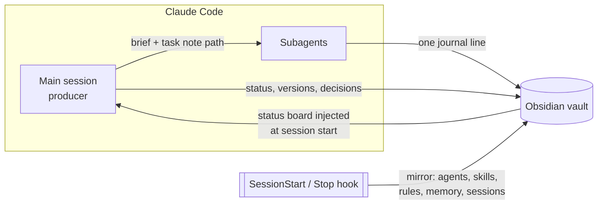

<p align="center"></p>

<h1 align="center">Showrunner</h1>

<p align="center"><b>Run a team of Claude Code agents from an Obsidian vault.</b><br>
One status board, a decision log that remembers what you rejected, and a live view of your whole agent setup.</p>

---

You have a main Claude session and a few subagents: a researcher, a writer, a designer, an editor. After a week you can't tell what's in progress, what's waiting for you, why version 4 was thrown out, or what the designer's prompt even says. Claude can't either: every new session starts by re-reading a 15 KB status file, or worse, by proposing the option you rejected on Tuesday.

Showrunner turns an Obsidian vault into the team's backlog and memory, and keeps it current without you.

## What you get

- **A status board Claude loads on its own.** `Status.md`: waiting for you, in progress, interrupted, next. A hook injects it at session start, so Claude knows where things stand before you type.
- **A kanban that maintains itself.** The status board is rebuilt as a kanban (`System/Board.md`) on every sync. One source of truth, two views, zero extra writes.
- **Decisions, including the rejected ones.** Each task note has *Now*, *Versions* and *Decisions*. "v04 rejected: too close to the reference" stays on record, so nobody proposes it again.
- **A summary on top of every note.** A folded two-line callout says what the note is and where it stands. Agents read it and skip notes that don't matter; you see the content first.
- **A health check that runs itself.** `System/Health.md` lists stuck tasks, broken links, missing fields and active tasks that fell off the board. Claude sees the count at session start and cleans up once a week.
- **A protocol for multi-agent writes.** The main session owns the status board and the decisions. Subagents append one line to a monthly journal. No collisions, no five agents rewriting the same note.
- **A live mirror of your setup.** Your agents and their prompts, skills, every `CLAUDE.md`, Claude's auto-memory: all browsable in Obsidian, rebuilt after every answer. You can finally see how your team is wired.
- **Session history you can read.** Each session becomes a note with your prompts in order, the projects it touched and the agents it called. Past months fold into one folder each. Tokens and API keys are masked.
- **Cheap on tokens.** Agents read the board, then Grep and open only the section they need. The vault is never dumped into context.
- **Works with Obsidian closed.** The vault is plain files on disk. If you run the Obsidian MCP server (Local REST API), agents also get heading-level reads and frontmatter queries.

## How it works



| Part | What it is |
|---|---|
| `skills/showrunner` | The read/write protocol: when to update what, how to read cheaply |
| `skills/setup` | `/showrunner:setup`: finds your vault, writes the config, scaffolds notes, wires `CLAUDE.md` and agents |
| `hooks/hooks.json` | Runs the sync at session start (and injects the board) and after every answer |
| `scripts/sync.py` | The mirror. Python standard library only, writes a file only when it changed, ~0.15 s on a warm cache |
| `templates/` | Vault skeleton, `CLAUDE.md` and agent snippets |

## Install

```text
/plugin marketplace add cmwname/obsidian-showrunner
/plugin install showrunner@showrunner
/showrunner:setup
```

Setup asks which vault to use (it reads Obsidian's vault list), which folders are separate projects, and whether to move an existing `STATUS.md` or `backlog.md` into the vault.

**Requirements:** Claude Code, Python 3.8+, bash (on Windows it comes with Git for Windows, which Claude Code already needs). Obsidian, with the Local REST API plugin for MCP access, is optional.

## Try the demo

[`examples/demo-vault`](examples/demo-vault) is the vault of a made-up cycling channel with three agents. Open it in Obsidian and start from `00 Home.md`. `System/` in it was generated from [`examples/demo`](examples/demo) by `python tools/build_demo.py`. Look at `System/Sessions/2026-10/` for the monthly folding and the masked token.

## Configuration

`.claude/showrunner.json` in your project. Without it the hooks do nothing, so the plugin is safe to install globally.

```json
{
  "vault": "~/Obsidian/team",
  "projects": { "channel": "Channel", "bot/": "Upload bot" },
  "rules": { "max_depth": 3, "exclude": ["vendor"] },
  "mirror": { "agents": true, "skills": true, "rules": true, "memory": true, "sessions": true },
  "inject_status": true,
  "inject_limit": 4000,
  "board": true,
  "health": { "stale_days": 7, "active_statuses": ["in progress", "waiting for owner"] }
}
```

| Key | Meaning |
|---|---|
| `vault` | Vault folder, absolute, `~/…` or relative to the project |
| `projects` | Folder or path substring → project hub name. Sessions that touched it link to the hub |
| `rules` | Where to look for `CLAUDE.md` files and which folders to skip |
| `mirror` | Turn parts of the mirror off |
| `inject_status`, `inject_limit` | Load the status board at session start, capped at N characters |
| `board` | Build the kanban view; `false` turns it off |
| `health` | `stale_days`: when an active task counts as stuck. `active_statuses`: which `status` values count as active, so you can keep your own vocabulary. `false` turns the check off |

## Privacy

- The vault holds your prompts. Keep it private; don't push it to a public repo.
- Masking is pattern-based: Telegram and AWS tokens, `sk-`/`ghp_`-style keys, JWTs, `password=…`, and any 40+ character blob outside a URL. It catches the common cases, not all of them. Setup greps the first sync for leftovers.
- Paths in generated notes are shown as `~/…` and `./…`, so your username doesn't end up in the vault.
- Nothing leaves your machine: no network calls, no telemetry.

## Compared to other Obsidian + Claude tools

There are good projects in this space. Showrunner is narrower: it doesn't try to be your second brain. It runs one team on one project and makes that team visible.

| | Showrunner | Second-brain kits ([obsidian-second-brain](https://github.com/eugeniughelbur/obsidian-second-brain), [obsidian-mind](https://github.com/breferrari/obsidian-mind)) | Session exporters ([agent-sessions-export](https://github.com/alexivanovvv/agent-sessions-export), [Claude Code Sync](https://community.obsidian.md/plugins/claude-code-sync)) |
|---|---|---|---|
| Focus | the agent team's status and decisions | your whole knowledge base | transcripts as notes |
| Status board loaded at session start | yes | partly (dashboards, context injection) | no |
| Kanban | generated from the status board | maintained by hand alongside status, daily and logs | no |
| Vault health check | every sync, count shown at session start | on demand (`/obsidian-health`, broader) | no |
| Rejected options as a first-class record | yes | ADR-style decisions | no |
| Who-writes-what rules for subagents | yes | not described | no |
| Mirror of agents, skills, rules, memory | yes | no | no |
| Session history with masking, folded by month | yes | partly | yes, that's their job (masking varies) |
| Footprint | 2 skills, 1 script, no dependencies | dozens of commands, Node or extra tools | one script or Obsidian plugin |

Based on their READMEs in November 2026. Corrections welcome.

## Limitations

- Claude Code only (hooks and transcript format). Codex and Gemini CLI are not supported.
- One project per vault is the tested setup. Several projects can share a vault if their hubs don't clash.
- The transcript format is not a public API; if Claude Code changes it, the session mirror may need an update.

## License

MIT
