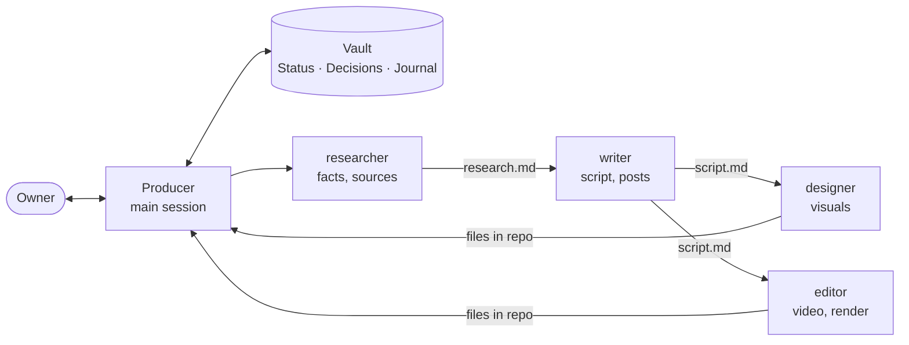

# Team

The main Claude session acts as the **producer**: it talks to the owner, briefs agents, passes file paths between them and keeps this vault. Agents don't see the conversation or each other; everything they need is in the brief.

## Who hands what to whom

Edit this diagram to match your team.

Order: facts → story → picture. A downstream agent never invents what belongs upstream.

## Checkpoints with the owner

| Flow | Stop at |
|---|---|
| Ideas | after ideas and hooks: which to take |
| Video | facts and angle → script → style → render |
| Design | options as images, the owner picks |

Summary at a checkpoint: up to 10 lines and full file paths.

## How the vault fits in

1. The producer reads [[Status]] and the project hub.
2. The brief to an agent has: goal, input paths, where to save, project rules (`CLAUDE.md`) and the task note's path in the vault.
3. The agent works in the repo and appends one line to the month's journal.
4. The producer shows the owner the result, logs the verdict in "Decisions", updates the status board.

Agents and their prompts: [[Agents]] (auto-mirror). Rules for agents: [[00 For agents]].
