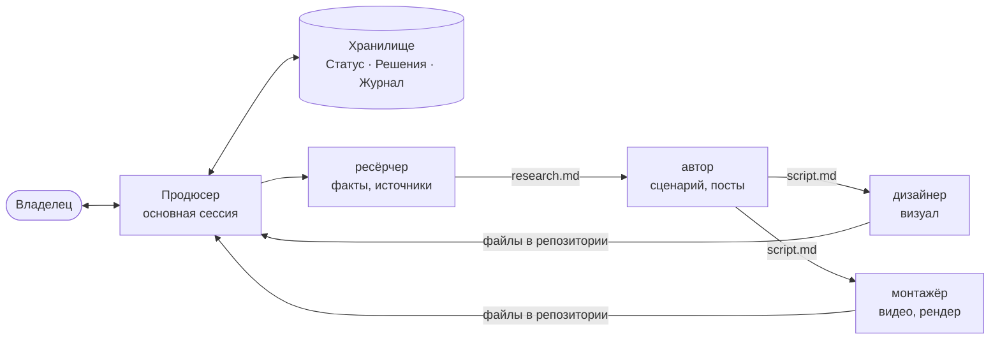

# Команда

Основная сессия Claude работает **продюсером**: говорит с владельцем, ставит задачи агентам, передаёт между ними пути к файлам, ведёт хранилище. Агенты не видят разговор и друг друга, всё нужное получают в задаче.

## Кто кому что передаёт

Поправь схему под свою команду.

Порядок: факты → история → картинка. Нижнее звено не придумывает то, что принадлежит верхнему.

## Контрольные точки с владельцем

| Сценарий | Где останавливаемся |
|---|---|
| Идеи | после идей и хуков: какие брать |
| Ролик | факты и угол → сценарий → стиль → рендер |
| Дизайн | варианты картинками, владелец выбирает |

Сводка на точке — до 10 строк и полные пути к файлам.

## Как хранилище встроено в работу

1. Продюсер читает [[Статус]] и хаб проекта.
2. В задаче агенту: цель, пути к входным файлам, куда сохранить, правила проекта (`CLAUDE.md`) и путь к заметке задачи в хранилище.
3. Агент работает в репозитории и дописывает строку в журнал месяца.
4. Продюсер показывает итог владельцу, записывает решение в «Решения», обновляет «Статус».

Агенты и их промпты: [[Агенты]] (автокопия). Правила для агентов: [[00 Агентам]].
